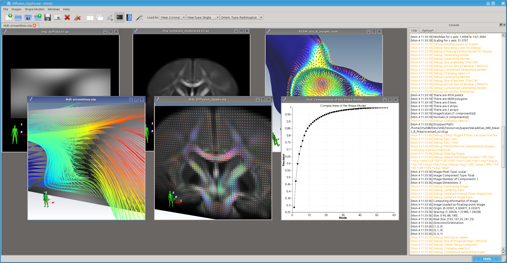

The **Simple Medical Imaging Library Interface (SMILI)**, pronounced *'smilie'*, is a lightweight C++/Qt/Python framework for the rapid development of biomedical imaging and scientific visualization applications. Please cite our SMILI publication if you find this project useful:

```text
Chandra, S. S.; Dowling, J. A.; Engstrom, C.; Paproki, A.; Neubert, A.; Xia, Y.; Rivest-Hénault, D.; Shen, K.-K.; Salvado, O.; Crozier, S. & Fripp, J.
"A simple framework for the rapid development of biomedical imaging applications"
Computer Methods and Programs in Biomedicine, vol. 164, pp. 193–205, 2018.
```

- **DOI**: <https://doi.org/10.1016/j.cmpb.2018.07.011>
- **Paper PDF**: [`papers/CMPB_Chandra2018.pdf`](papers/CMPB_Chandra2018.pdf)
- **Project Website**: <https://smili-project.sourceforge.io/>

---

## Introduction

SMILI is built around **Qt**, the **[Insight Toolkit (ITK)](https://itk.org/)**, and the **[Visualization Toolkit (VTK)](https://www.vtk.org/)**. It is divided into three main layers:

1. **`sMILX` (`apps/smilx`)**: A multi-window, tabbed MDI medical imaging and 3D surface visualization application (`milxQtMain`) supporting drag-and-drop volumes (NIfTI, DICOM, MHD, NRRD, Analyze, GIPL), surface meshes (VTK, VTP, STL, PLY, OBJ), 2D/3D/4D vector and tensor fields, multi-planar orthogonal slicing, linked cameras, and cross-window actor overlays (`Import View From`).
2. **`milxQt` (`src/Qt/`, `include/Qt/`)**: A Qt GUI-dependent library that wraps and extends `milxSMILI` into interactive, self-contained visualization widgets (`milxQtImage`, `milxQtModel`, `milxQtPlot`, `milxQtRenderWindow`, `milxQtUnifiedWindow`, `milxQtFile`).
3. **`milxSMILI` (`src/`, `include/`)**: A UI-independent core C++ library (`milx::Image<T>`, `milx::Model`, `milx::DeformableModel`, `milx::File`, `milx::Math`) that directly interfaces with ITK and VTK for standalone command-line tools and processing pipelines.

SMILI provides high-level, chainable access to medical image and mesh processing and visualization. For example, to clean, smooth, decimate, colour-map, and orient a polygonal surface in coronal view:

```cpp
model->clean();
model->smoothSinc(20); // windowed sinc 20 iterations
model->decimate(0.5);  // 50% decimation
model->colourMapToJet();
model->viewToCoronal();
```

Similar syntax is available from Python via the `PySMILI` (Shiboken6) bindings and the `sMILX` Python scripting interface.

---

## Prerequisites & Supported Toolchains

SMILI has been modernized to build and run against **Qt 6**, **VTK 9**, and **ITK 5** with a **C++17** compiler and **CMake 3.20+**:

| Component | Recommended Modern Toolchain | Notes |
| :--- | :--- | :--- |
| **CMake** | **3.20+** | Modern target-based configuration (`VTK::*`, `Qt6::*`, `ITK`) |
| **Qt** | **Qt 6.x** (tested on **6.10.2**) | Requires `Core`, `Gui`, `Widgets`, `OpenGL`, `OpenGLWidgets`, `WebEngineWidgets`, `UiTools` |
| **VTK** | **VTK 9.x** (tested on **9.6.0**) | Built with Qt 6 support (`VTK_GROUP_ENABLE_Qt=YES`, `VTK::GUISupportQt`) |
| **ITK** | **ITK 5.x** (tested on **5.4.3**) | Built with `Module_ITKVtkGlue=ON` (`ITKVtkGlue` bridged to VTK 9) |
| **Python Bindings (Optional)** | **Python 3.x + PySide6 / Shiboken6** | Used when `BUILD_PYSMILI=ON` |

> **Legacy Toolchain Note**: Historical builds using ITK 3.20+/4.x, VTK 5.8–7.x, and Qt 4/5 are preserved in the [`topic-qt5`](https://github.com/shakes76/smili/tree/topic-qt5) branch and legacy CMake fallbacks. Pre-requisite archives for older releases can also be found on [SourceForge](https://sourceforge.net/projects/smili-project/files/Dependencies/).

---

## Building & Testing SMILI

### 1. Configure & Build (Windows / Visual Studio 2022 Example)

```powershell
cmake -S . -B build-vs2022 -G "Visual Studio 17 2022" -A x64 `
  -DVTK_DIR="D:/Dev/VTK-9.6.0/build-vs2022" `
  -DITK_DIR="D:/Dev/InsightToolkit-5.4.3/build-vs2022" `
  -DCMAKE_PREFIX_PATH="D:/Qt/6.10.2/msvc2022_64" `
  -DBUILD_SHARED_LIBS=ON `
  -DBUILD_CLI_APPS=ON `
  -DBUILD_GUI_APPS=ON `
  -DBUILD_VIEWER=ON `
  -DBUILD_PLUGINS=ON `
  -DBUILD_EXAMPLES=ON `
  -DBUILD_TESTING=ON

cmake --build build-vs2022 --config Release --parallel 8
```

On Windows, the build system automatically places all libraries (`vtk-ext.dll`, `milx-SMILI.dll`, `milx-Qt.dll`) and executables (`smilx.exe`, CLI/GUI apps, and test binaries) into a unified runtime directory (`build-vs2022/bin/<Config>/`), deploys `sMILX` plugins into `build-vs2022/plugins/<Config>/`, and runs `vtkModuleCopyLibraries`, ITK DLL deployment, and `windeployqt` so executables run out-of-the-box without `PATH` errors.

### 2. Configure & Build (Linux / Ninja or Make)

```bash
mkdir build && cd build
cmake .. \
  -DBUILD_SHARED_LIBS=ON \
  -DBUILD_CLI_APPS=ON \
  -DBUILD_GUI_APPS=ON \
  -DBUILD_VIEWER=ON \
  -DBUILD_PLUGINS=ON \
  -DBUILD_TESTING=ON
cmake --build . --parallel
```

### 3. Run Automated Verification Tests (CTest)

```powershell
ctest --test-dir build-vs2022 -C Release --output-on-failure
```

The CTest suite verifies:
- CLI application smoke tests (`milxImageApp`, `milxDICOMApp`, `milxModelApp`, `milxDeformableModelApp`, `milxHausdorffDistance`).
- **`test_vtk9_itk5_pipeline`**: VTK 9.6 `QVTKOpenGLNativeWidget` & OpenGL 3.2 Core Profile initialization, `vtkImageViewer3` slicing, 64-bit `vtkIdType` ITK-to-VTK surface mesh conversion, and `milxQtPlot` chart rendering.
- **`test_qt6_smilx_gui`**: Qt 6 `milxQtMain` MDI subwindow management, `QActionGroup` window switching, `Import View From` (`customOperation`) actor overlays, preference dialogs, and clean destruction.
- **`test_smili_imaging_workflows`**: Physical coordinate preservation (`ResizeImage`, `ApplyOrientationToVTKImage`), 6-component DTI / 4D `itk::VectorImage` conversion, VNL and `std::vector`/NumPy deep-copy bridges, `milx::Model` collection algorithms, and NIfTI-to-mesh patient-space registration between `milxQtImage` and `milxQtModel`.

---

## Qt 6, VTK 9 & ITK 5 Porting & Gemini Multi-Agent Code Review

Following the initial migration of SMILI from Qt 4 / VTK 7 to Qt 6 / VTK 9, a structured **5-phase AI-assisted code review, remediation, and verification workflow** was conducted using **Google Gemini (Antigravity)** configured with three domain-specialist reviewer personas:

1. **Senior VTK/Kitware & ITK Developer (`senior-vtk-developer`)** — Audited the VTK 9.6 module system (`VTK::*`), `vtk_module_autoinit`, `QVTKOpenGLNativeWidget` OpenGL 3.2 Core Profile lifecycle, custom `vtk-ext` classes (`vtkImageViewer3`, `vtkInteractorStyleImage2`), ITK 5.4 `ITK_FUTURE_LEGACY_REMOVE` compatibility, and 64-bit `vtkIdType` mesh bridges.
2. **Senior Qt 6 GUI & CMake Developer (`senior-qt-developer`)** — Audited modern CMake 3.20+ target dependencies, `Qt6::*` (`Core`, `Gui`, `Widgets`, `OpenGL`, `OpenGLWidgets`, `WebEngineWidgets`), `QMdiArea` + `QVTKOpenGLNativeWidget` subwindow lifecycle, Qt 4/5 `SIGNAL()`/`SLOT()` and `QSignalMapper` replacements, and Windows runtime DLL deployment.
3. **Medical Imaging Researcher & SMILI Architect (`medical-imaging-researcher`)** — Audited dual-layer API consistency (`milx::*` vs. `milxQt*`), physical coordinate space and anatomical orientation (Radiological vs. Neurological conventions, direction cosines, origin/spacing), NIfTI volume-to-mesh patient-space registration (`ApplyOrientationToVTKImage` and `importFrom`), 2D/3D/4D multi-component volumes, mesh collections, and VNL/NumPy array memory ownership.

### Summary of Review Phases

| Phase | Focus Area | Review Documentation |
| :--- | :--- | :--- |
| **Phase 1** | CMake 3.20+ Build System, VTK 9 `vtk_module_autoinit`, ITK 5 `zlib`, Qt 6 Targets & Windows DLL Deployment | [`docs/review/phase1-cmake-audit.md`](docs/review/phase1-cmake-audit.md) |
| **Phase 2** | VTK 9.6 & ITK 5.4 Rendering Pipeline, `QVTKOpenGLNativeWidget`, `vtk-ext` Exports & 64-Bit Mesh Bridge | [`docs/review/phase2-vtk9-itk5-pipeline.md`](docs/review/phase2-vtk9-itk5-pipeline.md) |
| **Phase 3** | Qt 6 GUI Signal/Slot Modernization, `QMdiArea` Subwindow Management & `sMILX` Stability | [`docs/review/phase3-qt6-gui-stability.md`](docs/review/phase3-qt6-gui-stability.md) |
| **Phase 4** | Biomedical Imaging Orientation, NIfTI-to-Mesh Patient-Space Registration, 4D/DTI Volumes & Array Bridges | [`docs/review/phase4-medical-imaging-workflows.md`](docs/review/phase4-medical-imaging-workflows.md) |
| **Phase 5** | End-to-End Verification (`8/8` CTest Suites), Consolidated Audit Summary & Phase 6 Python Bindings Roadmap | [`docs/review/phase5-remediation-roadmap.md`](docs/review/phase5-remediation-roadmap.md) |

---

## Documentation Index

### 1. Gemini Code Review & Remediation Reports (`docs/review/`)
- **[Review Overview & Index (`docs/review/README.md`)](docs/review/README.md)** — Specialist agent roles, toolchain matrix, and phase index.
- **[Phase 1: CMake & Build System Audit (`docs/review/phase1-cmake-audit.md`)](docs/review/phase1-cmake-audit.md)**
- **[Phase 2: VTK 9.6 & ITK 5.4 Core & Rendering Pipeline (`docs/review/phase2-vtk9-itk5-pipeline.md`)](docs/review/phase2-vtk9-itk5-pipeline.md)**
- **[Phase 3: Qt 6 GUI Architecture & `sMILX` Stability (`docs/review/phase3-qt6-gui-stability.md`)](docs/review/phase3-qt6-gui-stability.md)**
- **[Phase 4: Biomedical Imaging & Scientific Visualization (`docs/review/phase4-medical-imaging-workflows.md`)](docs/review/phase4-medical-imaging-workflows.md)**
- **[Phase 5: Final Verification & Phase 6 Python Roadmap (`docs/review/phase5-remediation-roadmap.md`)](docs/review/phase5-remediation-roadmap.md)**

### 2. Developer & Design Documentation (`docs/`)
- **[Project Description (`docs/description.txt`)](docs/description.txt)** — Overview of SMILI and `sMILX` capabilities.
- **[Qt 6 Porting Notes (`docs/qt6_port.txt`)](docs/qt6_port.txt)** — Initial notes on migrating from Qt 5.15 to Qt 6 and `QVTKOpenGLNativeWidget`.
- **[Development Notes (`docs/development-notes.txt`)](docs/development-notes.txt)** — Internal design notes on subclassing windows, context menus, linked cameras (`transferViewToWindows`), 1% trimmed-histogram auto window/level, and 3D reslice cursors (`vtkImageViewer3`).
- **[Coding Paradigm (`docs/paradigm.txt`)](docs/paradigm.txt)** — Smart pointer, `QPointer`, memory management, and style conventions.
- **[Features List (`docs/features.txt`)](docs/features.txt)** — Core visualization features (volume rendering, plane widgets, 1D profiling, blending, streamlines).
- **[Build Notes (`docs/build.txt`)](docs/build.txt)** — Additional build notes and experimental plugin setup.
- **[Deployment Guide (`docs/deployment.txt`)](docs/deployment.txt)** — Packaging and deployment notes across platforms.
- **[FAQ (`docs/faq.txt`)](docs/faq.txt)** — Frequently asked questions.
- **[TODO & Known Issues (`docs/todo.txt`)](docs/todo.txt)** — Historical wishlist and tracked UI items.

### 3. Reference Publication & Interactive HTML Manuals (`papers/` & `resources/`)
- **[SMILI Journal Paper (`papers/CMPB_Chandra2018.pdf`)](papers/CMPB_Chandra2018.pdf)** — Chandra et al., *Computer Methods and Programs in Biomedicine*, 2018.
- **[`sMILX` User Manual (`resources/index.html`)](resources/index.html)** & **[Quick Start Guide (`resources/quick_start.html`)](resources/quick_start.html)** — Interactive HTML documentation (also accessible inside `sMILX` via `Help -> Help Contents` or the standalone `milxAssistant` app).
- **[`sMILX` Feature Guides (`resources/smilx_doc/`)](resources/smilx_doc/)**:
  - [Imaging Guide (`resources/smilx_doc/imaging.html`)](resources/smilx_doc/imaging.html)
  - [Models & Surfaces Guide (`resources/smilx_doc/models.html`)](resources/smilx_doc/models.html)
  - [Plotting Guide (`resources/smilx_doc/plots.html`)](resources/smilx_doc/plots.html)
  - [Plugins Overview (`resources/smilx_doc/plugins.html`)](resources/smilx_doc/plugins.html) & [Plugin Developer Guide (`resources/smilx_doc/plugin_guide.html`)](resources/smilx_doc/plugin_guide.html)
- **[CLI Application Manuals (`resources/apps_doc/`)](resources/apps_doc/)**:
  - [`milxImageApp` (`resources/apps_doc/milxImageApp.html`)](resources/apps_doc/milxImageApp.html)
  - [`milxModelApp` (`resources/apps_doc/milxModelApp.html`)](resources/apps_doc/milxModelApp.html)
  - [`milxOverlay` (`resources/apps_doc/milxOverlay.html`)](resources/apps_doc/milxOverlay.html)

---

## Plugins & Scripting for `sMILX`

- **DICOM Plugin (`plugin/dicom/`)**: Built automatically when `BUILD_PLUGINS=ON` using ITK's GDCM DICOM series reader/browser.
- **Animate Plugin (`plugin/animate/`)**: Built automatically when `BUILD_PLUGINS=ON` for generating movies and camera orbit animations (supports FFMPEG/AVI/Ogg writers depending on VTK configuration).
- **Python Bindings (`PySMILI` / `src/py/Shiboken/`)**: Enabled via `-DBUILD_PYSMILI=ON` using PySide6/Shiboken6. A roadmap for cross-platform Windows & Linux `PythonQt` and `Shiboken6` modernization is detailed in [Phase 5 Section 4 (`docs/review/phase5-remediation-roadmap.md`)](docs/review/phase5-remediation-roadmap.md#4-roadmap-for-phase-6-cross-platform-python-bindings-pythonqt--shiboken6).
- **Batch & Automation Scripts (`scripts/`)**: Example scripts for `sMILX` (`smilx_*`) and multiprocessing batch scripts (`batch_*`) for CLI/GUI tools (`milxOverlay`, etc.) are provided in the [`scripts/`](scripts/) directory.
